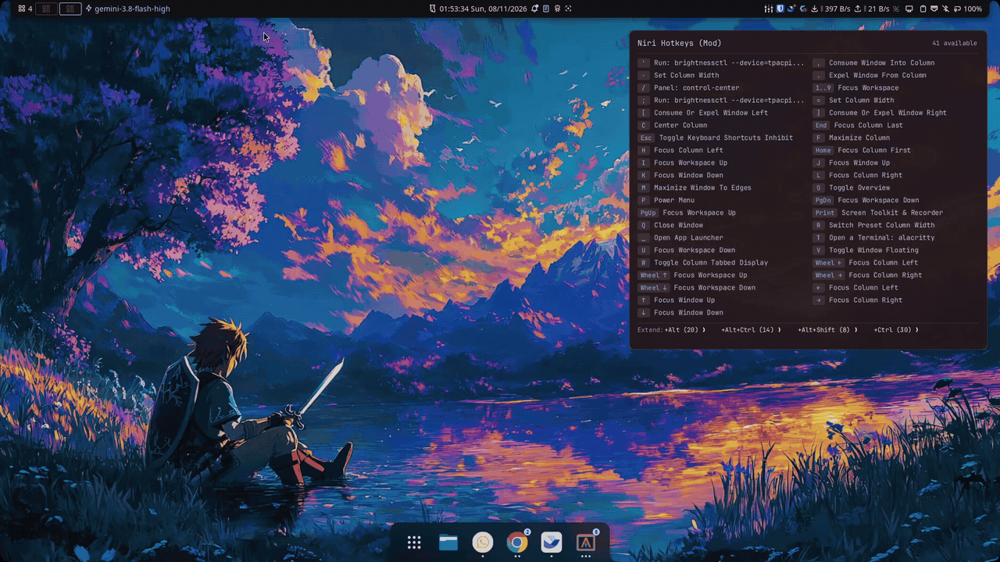

# niri-whichkey

[](https://github.com/bardiz12/niri-whichkey/actions/workflows/ci.yml)
[](https://github.com/bardiz12/niri-whichkey/releases)
[](LICENSE)

A blazing-fast, lightweight modifier-hint HUD overlay for the [Niri](https://github.com/YaLTeR/niri) scrollable-tiling Wayland compositor.

Inspired by `which-key.nvim`, `niri-whichkey` watches your modifier keys directly via `evdev` and displays an elegant HUD popup whenever `Mod` (or a combination of modifiers including `Mod`) is held down, showing you all available keybindings and sub-chords configured in your Niri setup.

<p align="center">
  
</p>

---

## ✨ Features

- **Dynamic Multi-Monitor Tracking**: Automatically detects and displays the HUD on whichever monitor is currently focused via Niri IPC; dynamically follows your active workspace across multiple displays.
- **Self-Healing evdev Loop**: Fully resilient across laptop sleep, suspend/resume cycles, and hotplugged keyboards. Re-enumerates input nodes automatically without hanging or crashing.
- **Modifier-Filtered Triggering**: Only activates when the `Mod` (Super) key is held. Holding standard modifiers like `Ctrl`, `Alt`, or `Shift` alone will not trigger the overlay.
- **Zero-Flicker & Zero Latency**: Keeps lightweight transparent buffers mapped on the Wayland layer-shell, completely avoiding compositor surface-renegotiation delay.
- **Smart Numeric Range Collapsing**: Automatically groups repetitive bindings (such as workspace focus `1`, `2`, `3` ... `9`) into a single, clean `1..9` badge to preserve HUD vertical space.
- **Prettified Badges & Symbols**: Key identifiers are automatically converted into intuitive visual symbols (e.g. arrow keys `←` `→` `↑` `↓`, `↵`, `⌫`, `␣`, `'`, `[`, `]`).
- **Live Configuration Reloads**: Watches Niri's IPC event stream and automatically refreshes its keybinding cache whenever Niri reloads its configuration.
- **Dedicated YAML Configuration**: Customize delays, margins, typography, and layout via `~/.config/niri-whichkey/config.yaml` or declaratively with Nix Home Manager.

---

## 📋 Prerequisites & Permissions

`niri-whichkey` listens for key states via Linux `/dev/input/event*` devices. To allow your user account to read input devices without root privileges, make sure your user belongs to the `input` group:

```bash
sudo usermod -aG input $USER
```

> **Note**: After adding yourself to the `input` group, log out and log back in (or run `newgrp input` in your terminal session) for permissions to take effect.

---

## 🚀 Installation

### 1. Via Nix Flake & Home Manager (Recommended)

Add `niri-whichkey` to your flake inputs:

```nix
{
  inputs = {
    nixpkgs.url = "github:nixos/nixpkgs/nixos-unstable";
    home-manager.url = "github:nix-community/home-manager";
    
    niri-whichkey = {
      url = "github:bardiz12/niri-whichkey";
      inputs.nixpkgs.follows = "nixpkgs";
    };
  };

  outputs = { self, nixpkgs, home-manager, niri-whichkey, ... }: {
    # In your Home Manager configuration:
    homeConfigurations."username@hostname" = home-manager.lib.homeManagerConfiguration {
      modules = [
        niri-whichkey.homeManagerModules.default
        {
          programs.niri-whichkey = {
            enable = true;
            settings = {
              threshold_ms = 200;
              margin_top = 24;
              margin_right = 24;
              font_size = 13.0;
              max_columns = 2;
            };
          };
        }
      ];
    };
  };
}
```

Or run directly without installing:

```bash
nix run github:bardiz12/niri-whichkey
```

### 2. From GitHub Releases (Pre-built Binary)

Download the latest release archive from the [Releases](https://github.com/bardiz12/niri-whichkey/releases) page:

```bash
curl -LO https://github.com/bardiz12/niri-whichkey/releases/latest/download/niri-whichkey-x86_64-linux.tar.gz
tar -xzf niri-whichkey-x86_64-linux.tar.gz
sudo install -m 755 niri-whichkey /usr/local/bin/
```

### 3. Build from Source using Cargo

```bash
# Install build dependencies (Arch / CachyOS)
sudo pacman -S --needed pkg-config wayland libxkbcommon

# Install directly from repository
cargo install --git https://github.com/bardiz12/niri-whichkey
```

---

## ⚙️ Configuration

`niri-whichkey` looks for a YAML configuration file in the following locations:
1. Path passed via `-c / --config <PATH>`
2. `$XDG_CONFIG_HOME/niri-whichkey/config.yaml` (or `config.yml`)
3. `~/.config/niri-whichkey/config.yaml` (or `config.yml`)

### Example Configuration (`~/.config/niri-whichkey/config.yaml`)

```yaml
# Delay in milliseconds before showing the overlay when modifier is held
threshold_ms: 200

# Margin from top and right screen edges in pixels
margin_top: 24
margin_right: 24

# Typography and columns
font_size: 13.0
max_columns: 2

# Path to niri configuration (defaults to ~/.config/niri/config.kdl or $NIRI_CONFIG)
# niri_config_path: ~/.config/niri/config.kdl
```

### Options Reference

| Option | Type | Default | Description |
| :--- | :--- | :--- | :--- |
| `threshold_ms` | integer | `200` | Hold duration in milliseconds required before showing the HUD. |
| `margin_top` | integer | `24` | Margin in pixels from the top of the monitor. |
| `margin_right` | integer | `24` | Margin in pixels from the right of the monitor. |
| `font_size` | float | `13.0` | Base text font size in points. |
| `max_columns` | integer | `2` | Maximum column layout for keybindings grid (`1` or `2`). |
| `niri_config_path` | string | `~/.config/niri/config.kdl` | Path to Niri's `config.kdl`. Supports `~` tilde expansion. |

### Command-Line Arguments

All configuration file options can be overridden using command-line arguments:

```bash
niri-whichkey --help
```

```text
niri-whichkey - Modifier hint overlay for Niri compositor

USAGE:
    niri-whichkey [OPTIONS]

OPTIONS:
    -c, --config <PATH>       Path to YAML configuration file
        --niri-config <PATH>  Path to niri config.kdl (default: ~/.config/niri/config.kdl)
        --threshold <MS>      Delay in milliseconds before showing overlay (default: 200)
        --margin-top <PX>     Margin from top screen edge in pixels (default: 24)
        --margin-right <PX>   Margin from right screen edge in pixels (default: 24)
        --font-size <PT>      Base font size in points (default: 13.0)
        --columns <NUM>       Maximum columns for key list (1 or 2, default: 2)
    -h, --help                Print this help message
    -v, --version             Print version information
```

---

## 🖥️ Autostart with Niri

To launch `niri-whichkey` automatically when starting your Niri session, add the following line to your `~/.config/niri/config.kdl`:

```kdl
spawn-at-startup "niri-whichkey"
```

---

## 📄 License

This project is licensed under the [MIT License](LICENSE).
